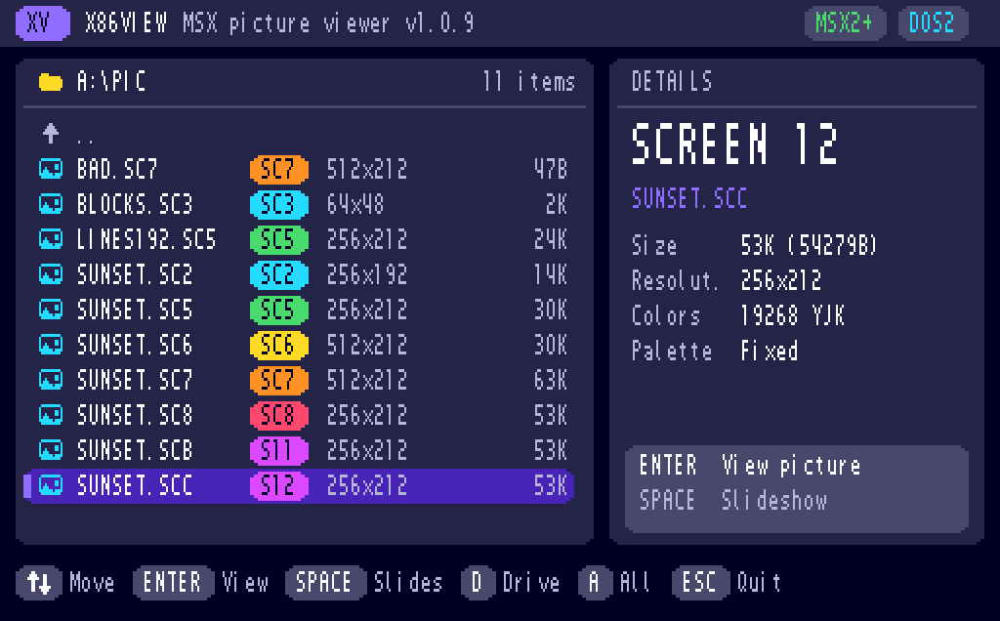
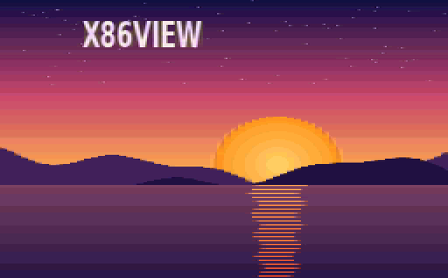

# X86VIEW

**A SCREEN-mode picture viewer for MSX2 / MSX2+ / MSX turbo R, running under MSX-DOS 2 / Nextor.**
**MSX2 이상 · MSX-DOS2 용 SCREEN 그림 뷰어**

Version **V1.2.0** · `X86VIEW.COM` (about 10 KB)



> The screenshots in this README were rendered by the author's Z80 test harness (a simulated BIOS / DOS / VDP), not captured from real hardware.
> 이 README의 화면은 실기 캡처가 아니라 작성자의 Z80 시험기(가짜 BIOS/DOS/VDP)로 그린 것입니다.

---

## English

### Features

- Views VRAM-dump pictures of **every graphic SCREEN mode**: SCREEN 2, 3, 4, 5, 6, 7, 8, 10, 11 and 12.
- Shows each picture full screen in its own SCREEN mode, with its embedded palette (SCREEN 5/6/7/10/11) or the MSX default palette.
- Dark, card-style file browser (drawn in SCREEN 7): format badges, resolution / colors / palette details, size, scrolling list, key-hint pills.
- Slideshow, previous / next picture, drive switching, folder navigation, command-line start.
- Pictures that need MSX2+ (SCREEN 10-12) are refused politely on MSX2.
- No ROM font needed: the 6x8 font is built in.
- **V9990 (Gfx9000) pictures (V1.2.0):** with a V9990 cartridge, `.G9B` pictures (256 or 512 pixels wide, up to 424 lines; BP2 / BP4 / BP6 / BD8 / BD16 / YJK / YUV, raw or BitBuster 2 packed) are listed and shown on the V9990 while the list stays on the MSX screen. Without a V9990 nothing changes.



### Requirements

| | |
|---|---|
| Computer | MSX2 or later (MSX2, MSX2+, MSX turbo R) |
| OS | MSX-DOS 2 or Nextor |
| VRAM | 128 KB (the browser uses SCREEN 7) |
| SCREEN 10 / 11 / 12 pictures | MSX2+ or turbo R (V9958) |

MSX1 is not supported (the program prints a message and exits).

### Compatibility

X86VIEW is written to the standard MSX2 / MSX2+ / MSX turbo R interfaces only (BIOS through the slot calls, MSX-DOS 2 functions, standard VDP ports and registers, no machine-specific tricks). It is therefore meant to run on **any MSX2 or later computer, real or emulated** (X86MSX, openMSX, blueMSX, MSXPLAYer, ...), as long as MSX-DOS 2 / Nextor is available and the machine has 128 KB of VRAM.

- MSX1 machines cannot run it (the V9938 is required). The program says so and exits.
- It has been checked only in the author's test harness and on X86MSX (turbo R GT) so far; see *Test status* below. Reports from other real machines and emulators are welcome.

### Supported files

Files saved with `BSAVE "name",0,end,S` (7-byte header `FEh`) or raw VRAM dumps without a header.

| Extensions | SCREEN | Size | Colors | Palette in file |
|---|---|---|---|---|
| `.SC2` `.GR2` `.S02` | 2 | 256x192 | 16 | - |
| `.SC3` `.S03` | 3 | 64x48 | 16 | - |
| `.SC4` `.S04` | 4 | 256x192 | 16 | - |
| `.SC5` `.SR5` `.GE5` `.S05` | 5 | 256x212 | 16 of 512 | at `7680h` |
| `.SC6` `.SR6` `.GE6` `.S06` | 6 | 512x212 | 4 of 512 | at `7680h` |
| `.SC7` `.SR7` `.GE7` `.S07` | 7 | 512x212 | 16 of 512 | at `FA80h` |
| `.SC8` `.SR8` `.GE8` `.S08` | 8 | 256x212 | 256 | fixed |
| `.SCA` `.SRA` `.S10` | 10 | 256x212 | YJK + RGB | at `FA80h` |
| `.SCB` `.SRB` `.S11` | 11 | 256x212 | YJK + RGB | at `FA80h` |
| `.SCC` `.SRC` `.GEC` `.S12` | 12 | 256x212 | 19268 (YJK) | - |

If a SCREEN 5/6/7 file has no palette inside, the first 32 bytes of a file with the same name and extension `.PL5` / `.PL6` / `.PL7` (Graph Saurus style) are used. Graph Saurus *packed* files (first byte `FDh`) are not supported yet and are reported as "Packed file (FD)".

#### V9990 pictures (`.G9B`)

Only shown when a V9990 answers on ports 60h-6Fh. The picture is written straight to the V9990 (packed data is unpacked on the fly with a 2 KB window), the V9990 is switched on, and the browser stays on the MSX screen with "Showing on V9990". Leaving the viewer switches the V9990 display off.

| Item | Supported |
|---|---|
| Width | 256 (B1) or 512 (B3) pixels |
| Height | 1 to 424 lines (more than 212 lines uses interlace, EO + IL) |
| Colour | BP2, BP4, BP6 (palette in the file), BD8, BD16, YJK, YUV |
| Packing | none or BitBuster 2 (the G9B packing) |
| Not yet | widths 384 / 640 / 768 (B2, B4-B6), P1 / P2, `.VGF` |

On X86MSX the V9990 picture is only visible with the screen source set to V9990 or to "side by side". Interlaced double height (424 lines) may not be emulated there.

Unknown extensions are hidden; press `A` to show all files. The mode is guessed from the file size, and `M` in the viewer re-interprets the picture as another SCREEN mode.

### Usage

```
X86VIEW                   start in the current folder
X86VIEW folder            start in that folder
X86VIEW folder\PIC.SC5    show that picture at once (ESC returns to the list)
X86VIEW /?                help
```

**File browser**

| Key | Action |
|---|---|
| Up / Down | select |
| `[` `]` | page up / down |
| HOME | first entry |
| Enter / Right | view picture / open folder |
| Left / BS | parent folder (the folder you came from stays selected) |
| Space | slideshow from the selected picture |
| D | drive pulldown (Up/Down + Enter, or press the drive letter; ESC closes) |
| A | show / hide non-picture files |
| R | refresh |
| ESC / Q | quit |

**Picture viewer**

| Key | Action |
|---|---|
| Right / Left | next / previous picture |
| Space | slideshow on / off |
| 1 - 9 | slideshow interval in seconds |
| M | re-read as the next SCREEN mode |
| R | back to the guessed mode |
| ESC / Enter / BS | back to the list |

### Build

[Pasmo](https://pasmo.speccy.org/) 0.5.3 is used.

```
cd src
pasmo --bin main.asm X86VIEW.COM
```

### How it works (short)

- The browser is drawn directly into VRAM in SCREEN 7 with the V9938 command engine (rounded rectangles) and a built-in 6x8 font.
- A picture is loaded in 2 KB chunks from the file straight into VRAM at the address stored in the BSAVE header; the palette bytes are picked out of the same stream.
- SCREEN 10-12 are set up as SCREEN 8 plus the YJK bits of VDP register 25, because some BIOSes do not accept those mode numbers in `CHGMOD`.
- On turbo R a short wait is inserted between VDP data writes.

### Test status

| Machine | Status |
|---|---|
| Z80 test harness (simulated BIOS / DOS / VDP / V9990) | pictures of SCREEN 2, 3, 5, 6, 7, 8, 11, 12, browser, scrolling, slideshow, random key test: OK. V9990: five sample G9B files (BitBuster 2) match the reference decode byte for byte; raw, palette and damaged files OK |
| X86MSX (turbo R GT) | browser and SCREEN 12 picture checked by the author |
| DPC-200 (MSX1) | refuses to start by design (not tested on hardware) |
| Daewoo CPC-400 | not tested yet |
| Panasonic FS-A1WX | not tested yet |

Reports from real machines are welcome.

### License and credits

- Source code: **GNU General Public License v3** (see `LICENSE`). Copyright (C) 2026 Kim Taewoo.
- Built-in font: **Galmuri7**, (c) 2019-2024 quiple, SIL Open Font License 1.1 (see `LICENSE-Galmuri.txt`).
- BitBuster 2 unpacking follows the format of `bitbuster.asm`, (c) 2003-2004, 2022 Arjan Bakker (Team Bomba), MIT License. The G9B format is by Team Bomba (GFX9k library).
- The sample pictures in `SAMPLE/` were generated by the author for testing.

---

## 한국어

### 기능

- **모든 그래픽 SCREEN 모드**(2, 3, 4, 5, 6, 7, 8, 10, 11, 12)의 VRAM 덤프 그림을 봅니다.
- 그림은 해당 SCREEN 모드로 전체 화면에 표시하고, 파일에 든 팔레트(SCREEN 5/6/7/10/11)를 쓰거나 MSX 기본 팔레트를 씁니다.
- 어두운 카드형 파일 목록(SCREEN 7): 형식 배지, 해상도·색 수·팔레트 정보, 크기, 스크롤, 키 안내 알약.
- 슬라이드쇼, 이전/다음 그림, 드라이브 바꾸기, 폴더 이동, 명령줄 시작.
- MSX2+ 가 필요한 그림(SCREEN 10~12)은 MSX2 에서 안내만 하고 열지 않습니다.
- ROM 글꼴이 필요 없습니다. 6x8 글꼴이 프로그램에 들어 있습니다.
- **V9990(Gfx9000) 그림(V1.2.0):** V9990 카트리지가 있으면 `.G9B` 그림(가로 256/512, 세로 424줄까지, BP2·BP4·BP6·BD8·BD16·YJK·YUV, 압축 없음 또는 BitBuster 2)을 목록에 보여 주고 V9990 화면에 띄웁니다. 목록은 MSX 화면에 그대로 있습니다. V9990 이 없으면 아무것도 달라지지 않습니다.

### 필요한 것

MSX2 이상, MSX-DOS2 또는 Nextor, VRAM 128KB. SCREEN 10~12 그림은 MSX2+ / turbo R 에서만 보입니다. MSX1 은 지원하지 않습니다.

### 호환성

X86VIEW 는 표준 MSX2 / MSX2+ / MSX turbo R 인터페이스(슬롯 호출을 통한 BIOS, MSX-DOS 2 기능, 표준 VDP 포트와 레지스터)만 쓰고 기종마다 다른 방법은 쓰지 않습니다. 그래서 MSX-DOS 2 / Nextor 가 있고 VRAM 이 128KB 인 **MSX2 이상의 모든 MSX 와 에뮬레이터**(X86MSX, openMSX, blueMSX, MSXPLAYer 등, 실기 포함)에서 돌아가도록 만들었습니다. MSX1 은 V9938 이 없어서 실행되지 않고 안내만 하고 끝납니다. 확인은 아직 작성자의 시험기와 X86MSX(turbo R GT)에서만 했습니다.

팔레트가 파일에 없는 SCREEN 5/6/7 그림은 같은 이름의 `.PL5` / `.PL6` / `.PL7` 파일(그래프 사우루스 방식) 앞 32바이트를 팔레트로 씁니다. 그래프 사우루스의 압축 파일(첫 바이트 `FDh`)은 아직 지원하지 않고 "Packed file (FD)"로 알려 줍니다.

### 쓰는 법

`X86VIEW`, `X86VIEW 폴더`, `X86VIEW 폴더\파일.SC5`, `X86VIEW /?` (위 영어 표의 키와 같습니다).

- 목록: ↑↓ 고르기, Enter 보기·폴더 열기, ←/BS 위 폴더, Space 슬라이드쇼, D 드라이브 풀다운(↑↓ Enter 또는 드라이브 글자), A 그림 아닌 파일도 보기, ESC 끝
- 그림 보기: →/← 다음/이전 그림, Space 슬라이드쇼, 1~9 간격(초), M 다른 SCREEN 으로 다시 해석, R 원래대로, ESC 목록으로

### 빌드

`pasmo --bin main.asm X86VIEW.COM` (Pasmo 0.5.3, `src` 폴더).

### 시험 현황

시험기(Z80 + 가짜 BIOS/DOS/VDP)와 X86MSX turbo R GT 에서 확인했습니다. DPC-200 은 MSX1 이라 의도적으로 실행되지 않습니다. CPC-400, FS-A1WX 는 아직 시험하지 못했습니다.

### 라이선스와 출처

소스 라이선스는 GNU GPL v3 입니다(`LICENSE`, Copyright (C) 2026 Kim Taewoo). 내장 글꼴 Galmuri7 은 SIL OFL 1.1 입니다(`LICENSE-Galmuri.txt`). `SAMPLE/` 의 그림은 시험용으로 직접 만든 것입니다. BitBuster 2 압축 해제는 Arjan Bakker(Team Bomba)의 `bitbuster.asm`(MIT) 형식을 따릅니다. G9B 형식은 Team Bomba(GFX9k 라이브러리)의 것입니다.
